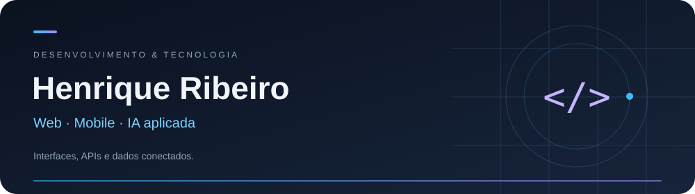
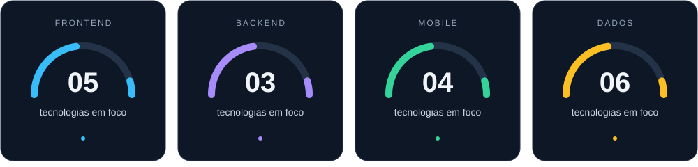

 

## Sobre mim

Sou Henrique Ribeiro, estudante de Engenharia de Software na PUC-Campinas. Meu foco está na interseção entre **estratégia de negócios, gestão de projetos e tecnologia**, conectando necessidades de mercado a soluções eficientes. 

Atuo no desenvolvimento de negócios e arquitetura de projetos, passando por aplicações web, mobile e integrações com inteligência artificial. Nos bastidores do código, estudo concorrência e sincronização de threads com Java, além de modelagem de dados e integrações complexas.

## Linguagens

**JavaScript · Dart · Kotlin · Java · Python**  
HTML · CSS

## Meu universo de ferramentas e tecnologias

## 

## As áreas abaixo destacam as principais ferramentas, frameworks e metodologias que utilizo no dia a dia.

### Gestão de Projetos e Inovação

## 

## **Scrum · Kanban · Jira · Trello · Confluence · Miro · Figma**

## Liderança técnica, estratégia comercial, metodologias ágeis, prototipação de interfaces e organização de fluxos de trabalho.

### Frontend

## 

## **React · Next.js · Vite · Tailwind CSS**

## Componentes reutilizáveis, interfaces responsivas, navegação, animações e internacionalização.

### Backend

## 

## **Node.js · NestJS**

## APIs robustas, autenticação com JWT, validação de dados e integração entre serviços.

### Mobile

##

## **Flutter · Android**

## Aplicativos multiplataforma focados em performance, notificações e integração nativa com recursos do dispositivo.

### Dados

## 

## **MongoDB · Neo4j · Redis · Oracle · SQLite · Firebase (Firestore) · DynamoDB**

## Bancos relacionais, modelagem de grafos, armazenamento em memória, documentos e serviços em nuvem.

## IA e visualização de dados

- **IA aplicada:** Ollama, llama.cpp e integração com Gemini.
- **Áudio:** Integração com Google Cloud Speech para transcrição.
- **Dashboards e gráficos:** Recharts e fl_chart.
- **Interações e movimento:** Animações CSS.

## Arquitetura e versionamento

**Clean Architecture · Monorepos · OpenAPI**  
Docker · Git · pnpm workspaces

---

**Vamos conectar ideias </>**

[Converse comigo no LinkedIn](https://www.linkedin.com/in/henriquerib/)

